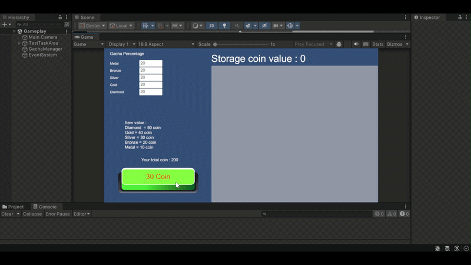

# Testing Task for Nagih Game

## About
This project is developed as part of the Game Programmer Internship at Polytron.
It was created using Unity 2022.3.62f2 ad features a gacha system where players
spend coins to roll items of five rarities, sell them back for coins, and try not to run out of coins.

| Gameplay Demo |
|:---:|
|  |

## Features
- Gacha cost 30 coins, starting with 200 coins
- Customizable rarity percentages via input field
- Storage sorting from Diamond to Metal
- Click an item in the storage to sell it for coins
- Storage coin value updates automatically
- Game over when player coins + storage value < 30

## How to Run
1. Clone this repository
2. Open it with Unity Hub using Unity version 2022.3.62f2 (first import may take a few minutes)
3. Open the scene Gameplay in Assets/Scenes/Gameplay.unity
4. Press Play

## How the Gacha Works
Each rarity has an input value (weight).
The effective chance of a rarity is its weight divided by the sum of all weights.
For example, with inputs [Metal 20, Bronze 10, Silver 0, Gold 10, Diamond 0], the total is 40,
so the chances are Metal 50%, Bronze 25%, and Gold 25%.

To pick a result, the game rolls a random number between 0 and the total,
then adds up the weights one by one until the running sum passes the rolled number.
The rarity at that point is the result. A rarity with weight 0 can never be picked.
If all weights are 0, the gacha is rejected and a log message is shown.
